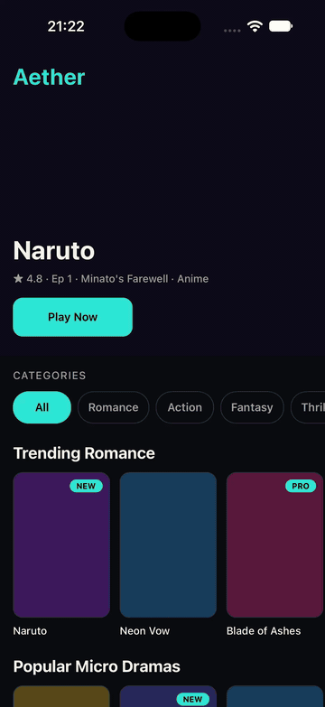

# Aether

Bare React Native mock: home feed, portrait player, cliff lock, one rewarded-ad unlock per visit.

Accessibility is covered: screen reader labels, roles, and focus on the feed, player, cliff lock, and rewarded ad.

## Getting Started

### Prerequisites

Ensure you have the following installed:

- [Node.js](https://nodejs.org/) ≥ 22.11
- Ruby 3.2.3
- iOS 15.1

### Installation

Clone the repository and install dependencies:

```sh
git clone https://github.com/godswillokokon/TargetVideo.git
cd TargetVideo
npm install
```

### Running the App

#### iOS

```sh
cd ios
bundle install
bundle exec pod install
cd ..
npm start
npm run ios
```

#### Android

```sh
npm run android
```

## Testing

```sh
npm test
npm run typecheck
npm run lint
```

## Demo



1. **Play Now** on Naruto.
2. Cliff at ~19s (`cliffRatio` 0.2 of `assets/video/naruto/s1e1.mp4`).
3. **Watch a short ad** for 5s. Playback resumes.
4. Leave and reopen. Locked again.


Catalog: [`assets/catalog.json`](assets/catalog.json). Only Naruto s1e1 has a video, registered in [`src/data/assets.ts`](src/data/assets.ts).
